# Dendro · retratos EEG

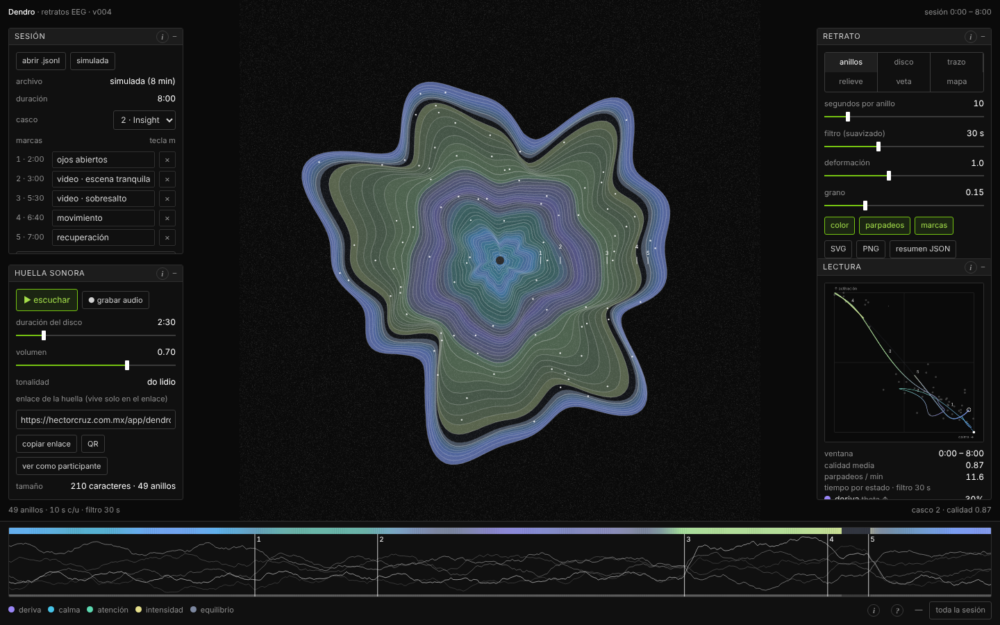

**Versión v004** · noviembre de 2026 · colección Alchemy of Meaning

## Español

**Dendro convierte la actividad bioeléctrica de una persona, registrada mientras vive una escena, en un retrato visual y sonoro que puede llevarse consigo.**

Toma su nombre de la dendrocronología: así como los anillos de un árbol guardan los años que vivió, cada retrato guarda los minutos que una persona pasó frente a una obra. Los datos llegan de un casco EEG de consumo (Emotiv Insight o EPOC+) a través del puente [Alquimia EEG OSC](https://github.com/loquellega/alquimia-eeg-osc).

### Qué hace

- **Seis vistas**, con el tiempo de izquierda a derecha (o del centro hacia afuera en las circulares):
  - **anillos:** el corte transversal de un tronco
  - **disco:** una espiral que se escucha
  - **trazo:** horizonte y carriles, como un electrocardiograma
  - **relieve:** una cordillera por banda
  - **veta:** el corte longitudinal de la madera
  - **mapa:** la trayectoria entre calma y activación
- **Color por estado**, con una paleta fría: deriva (theta), calma (alfa), atención (beta baja), intensidad (beta alta y gamma) y equilibrio. Un filtro ajustable de 0 a 90 s permite leer la evolución sin ruido.
- **Fragmentos:** al arrastrar sobre la línea de tiempo se hace el retrato de un solo momento. Las marcas conectan lo que pasó en escena con la señal.
- **Huella sonora:** el disco suena como un vinil. La huella completa cabe en un enlace o un QR de unos 200 caracteres y no guarda datos en ningún servidor. También se puede grabar como audio (webm).
- **Página del participante:** al abrir un enlace de huella aparecen el agradecimiento, el disco, el botón para escucharlo y el aviso ético.
- **Exportar:** SVG (apto para plotter), PNG de 2400 px y un resumen JSON por anillos.
- **Información:** un botón **i** en cada ventana explica qué se ve.

### Qué mide y qué no

Un EEG registra la suma de la actividad eléctrica de millones de neuronas cercanas a la superficie del cerebro: **no lee pensamientos ni emociones, y no es un diagnóstico**. Los estados se calculan **en relación con la propia sesión**. Los nombres son metáforas de trabajo para ritmos que la literatura asocia, con matices, a esos estados. En electrodos secos, gamma suele ser actividad muscular.

### Uso

1. Abre `index.html` en el navegador. No necesita instalación ni servidor.
2. Carga una grabación `.jsonl` del puente (`cortex_osc.py --grabar`) o usa la **sesión simulada**.
3. Elige una vista, ajusta el filtro y agrega marcas con la tecla `m`.
4. En **huella sonora**, escucha el disco, copia el enlace o genera el QR.

Para que los enlaces de huella funcionen, publica `index.html` en tu servidor (por defecto `https://hectorcruz.com.mx/app/dendro/`; la dirección se cambia en el panel). La página lee la huella del parámetro `?h=`.

Atajos de teclado:

| Tecla | Acción |
| --- | --- |
| `1`–`6` | Cambiar de vista |
| `espacio` | Escuchar o detener |
| `m` | Marca |
| `i` | Información de la vista |
| `h` | Ocultar la interfaz |
| `Esc` | Volver a toda la sesión |

### Ética

- Consentimiento informado.
- Anonimato.
- Caducidad del EEG crudo.
- Derecho a retirarse y a borrar.
- Sin menores.
- Procesamiento local en el navegador.

## English

**Dendro turns a person's bioelectrical activity, recorded while they experience a performance, into a visual and sonic portrait they can take home.**

Named after dendrochronology: just as tree rings keep the years a tree lived, each portrait keeps the minutes a person spent in front of a work. Data comes from a consumer EEG headset (Emotiv Insight or EPOC+) through the [Alquimia EEG OSC](https://github.com/loquellega/alquimia-eeg-osc) bridge.

- **Six views:**
  - **rings:** a tree cross-section
  - **disc:** a spiral you can listen to
  - **trace:** an ECG-like horizon with band lanes
  - **relief:** one ridge per band
  - **grain:** a lengthwise wood cut
  - **map:** the trajectory between calm and activation
- **Time flows** left to right, or from the centre outwards in the circular views.
- **Cool palette** by state, with an adjustable smoothing filter.
- **Sound fingerprint:** the disc plays like a record. The whole fingerprint fits in a ~200-character link or QR code, so no data is stored on any server.
- **Exports:** SVG, PNG and a JSON summary.
- **Info buttons** in every panel.

EEG sums the electrical activity of many neurons near the surface of the brain. It **does not read thoughts or emotions and is not a diagnosis**. States are relative to the person's own session.

Usage: open `index.html`, load a `.jsonl` recording from the bridge or try the simulated session. To share fingerprint links, host the file on a web server; the page reads `?h=`.

## Capturas / Screenshots

| | | |
| --- | --- | --- |
|  Anillos / Rings | 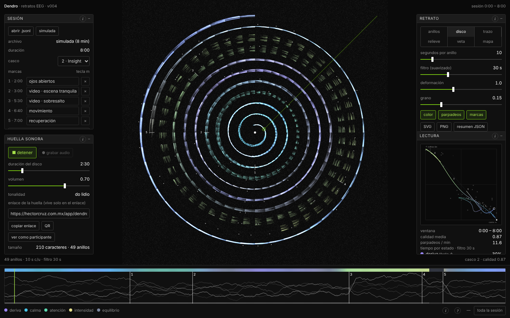 Disco sonando / Disc playing | 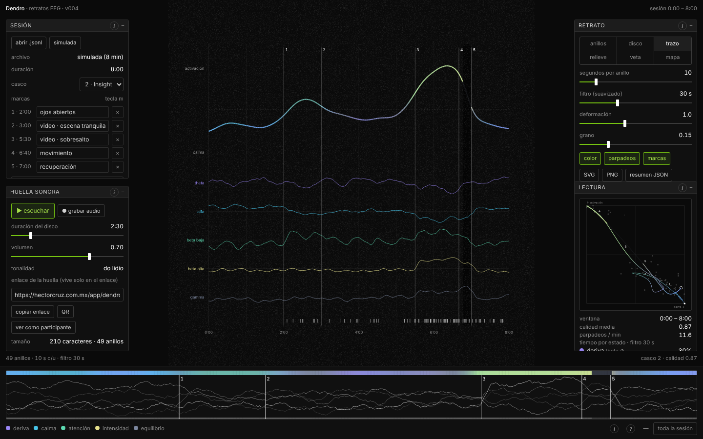 Trazo / Trace |
| 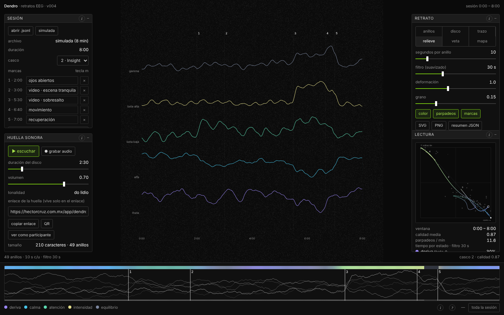 Relieve / Relief | 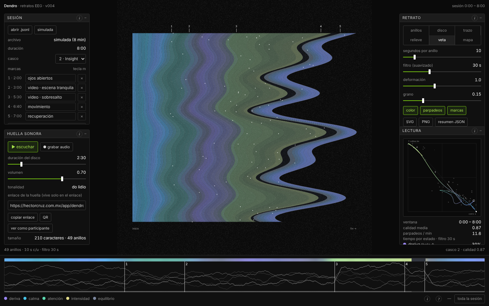 Veta / Grain | 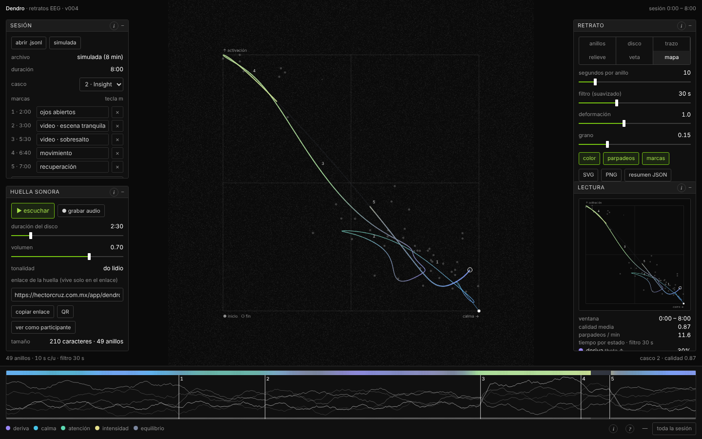 Mapa de estados / State map |
| 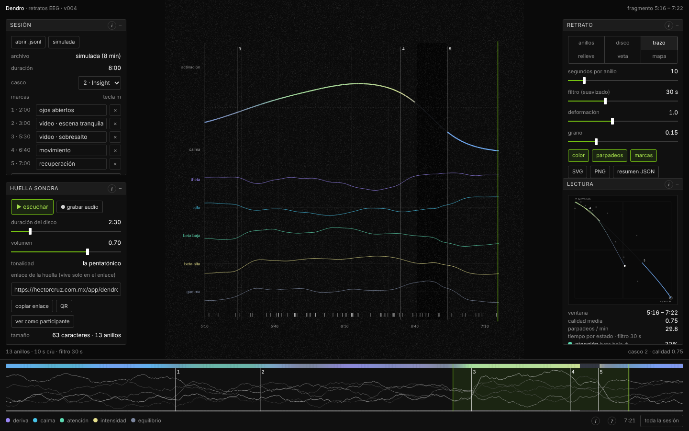 Fragmento / Fragment | 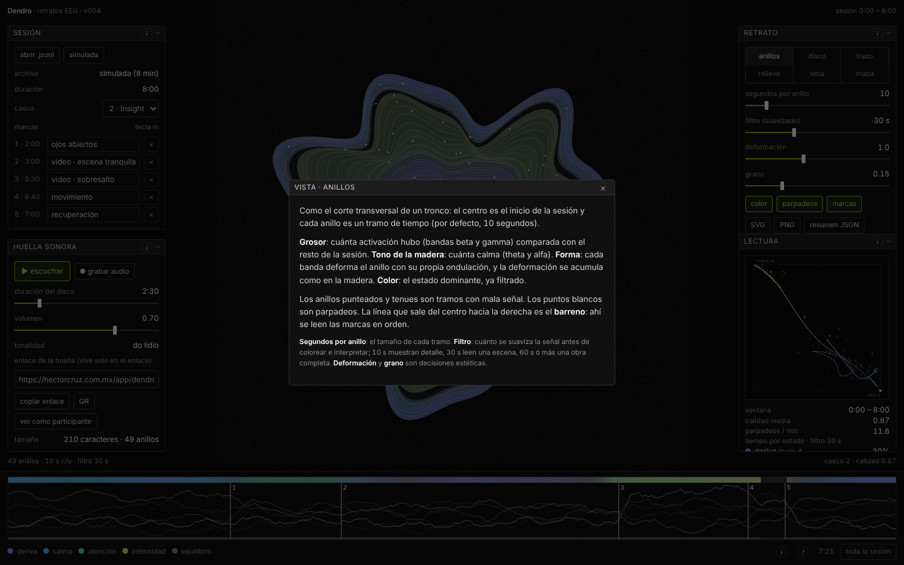 Información / Info | 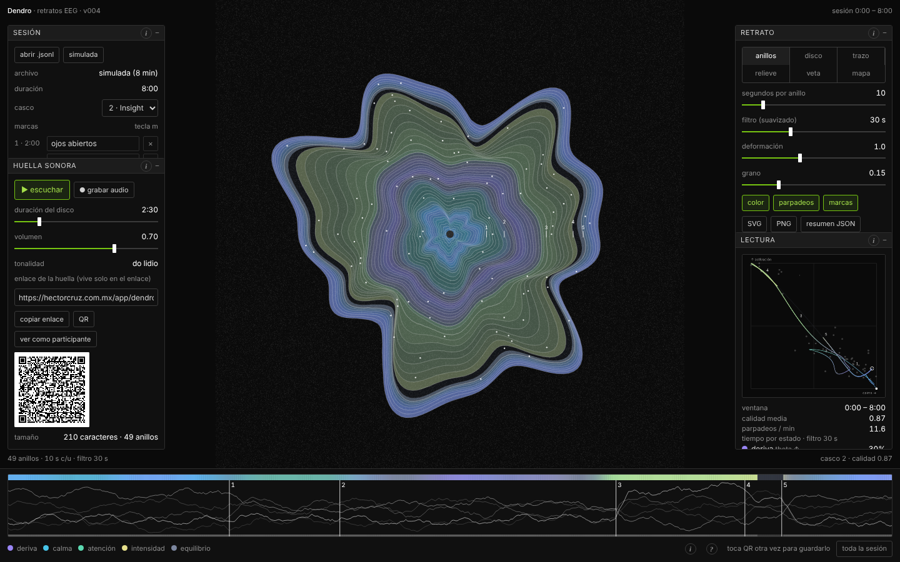 Huella y QR / Fingerprint & QR |
| 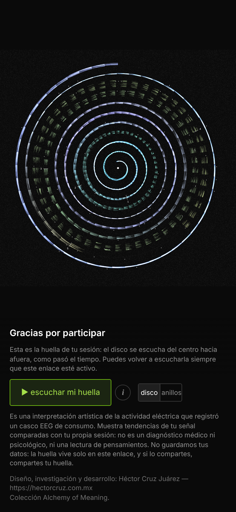 Participante (móvil) / Participant (mobile) | 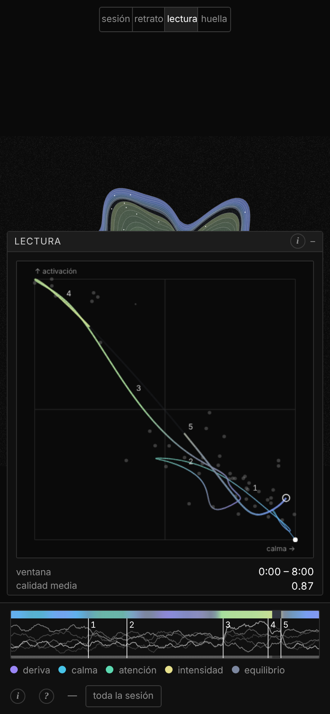 Lectura (móvil) / Reading (mobile) | 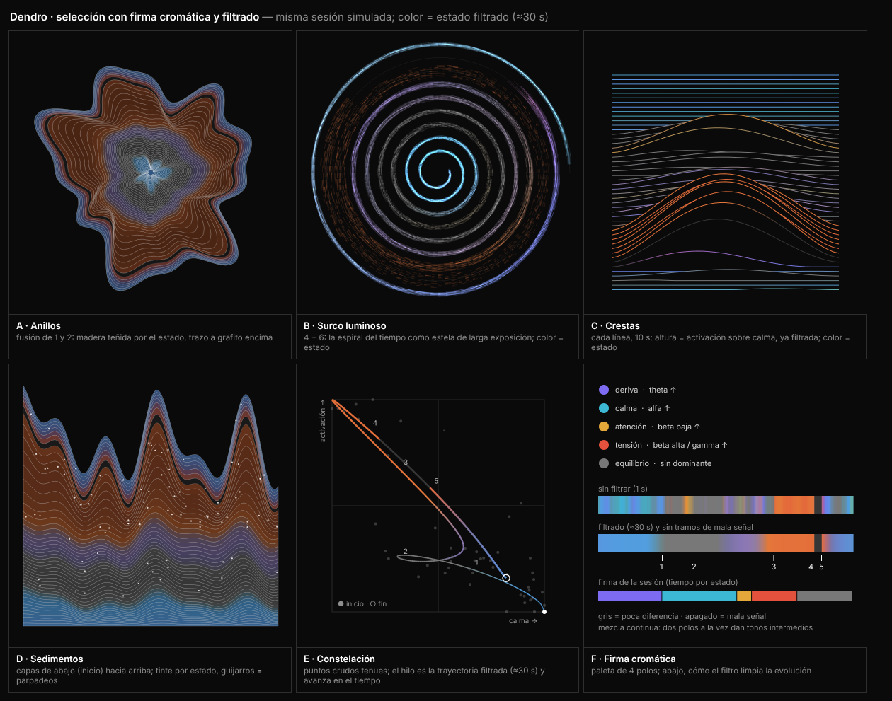 Proceso: firma cromática / Process: colour signature |

## Licencia / License

GPL-3.0-or-later. Incluye / includes [qrcode-generator](https://github.com/kazuhikoarase/qrcode-generator) 1.4.4 de Kazuhiko Arase (MIT).

## Créditos / Credits

Diseño, investigación y desarrollo: Héctor Cruz Juárez — https://hectorcruz.com.mx  
Colección Alchemy of Meaning.
